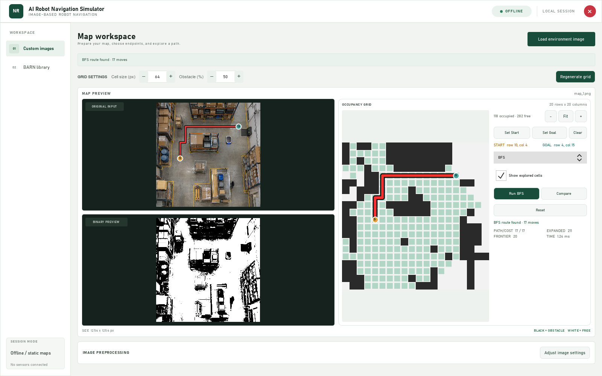
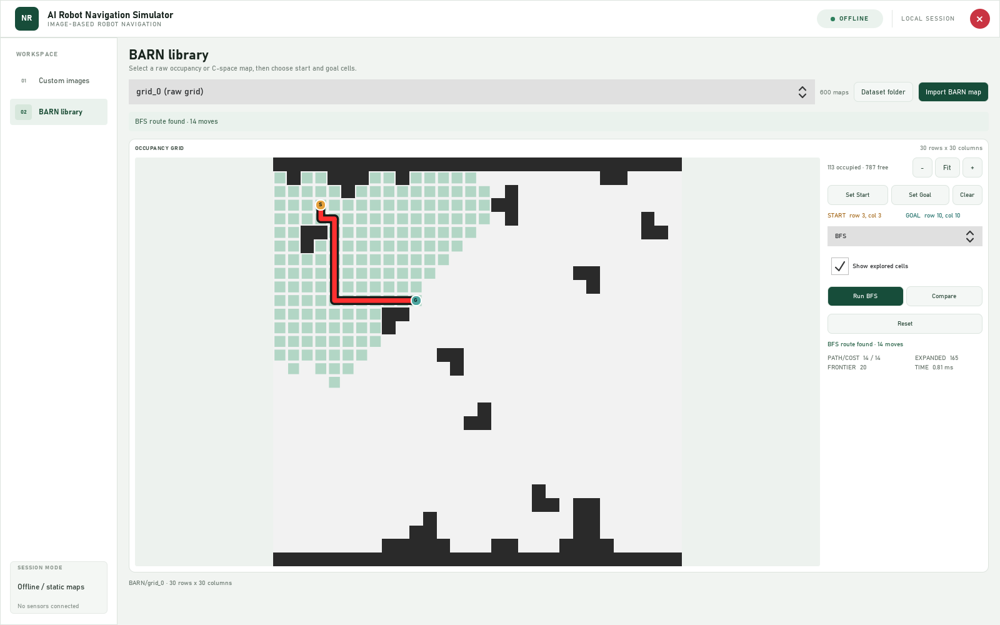
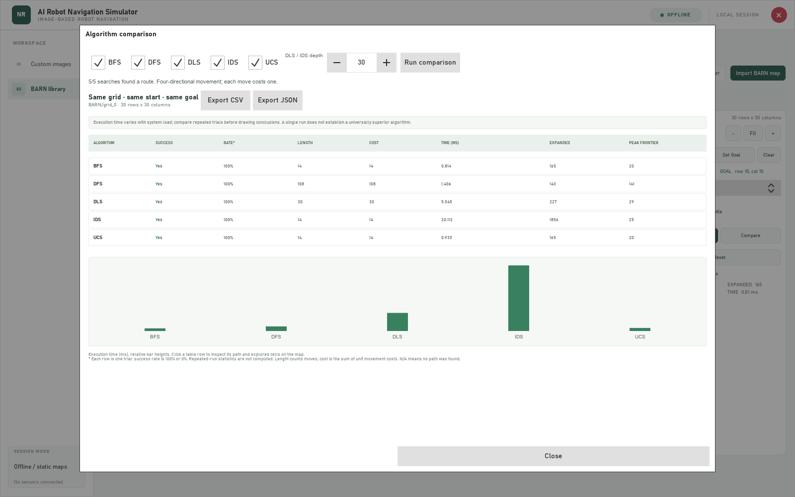
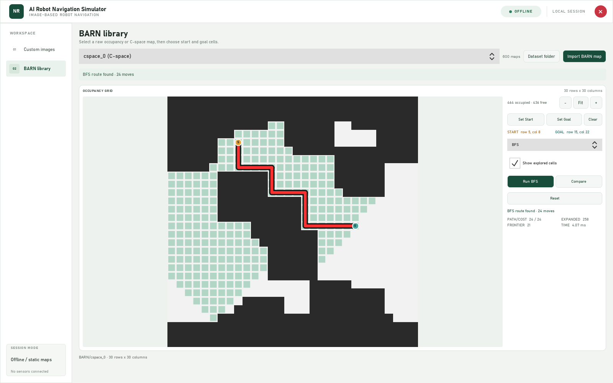
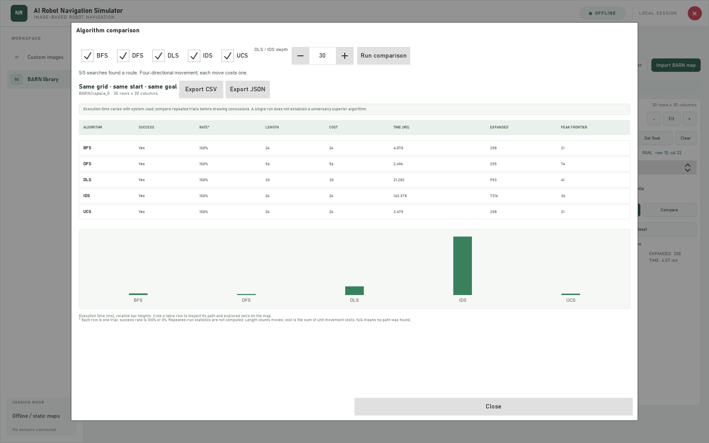
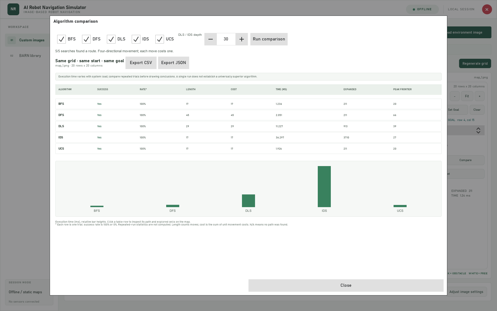

# AI-Based Robot Navigation Simulator

An offline desktop simulator for **image-based robot navigation using image processing and classical AI search**. It turns static environment images into occupancy grids, finds routes between selected cells, and compares search algorithms using measured results.

The project supports course experiments with custom images and compatible maps from the Benchmark for Autonomous Robot Navigation (BARN). It uses no physical robot, sensors, ROS, Gazebo, cloud services, deep learning, or model training.

## Contents

- [Objectives and features](#objectives-and-features)
- [Technology stack](#technology-stack)
- [Installation](#installation)
- [Run](#run)
- [Application pages and controls](#application-pages-and-controls)
- [Custom-image workflow](#custom-image-workflow)
- [Preprocessing and resolution settings](#preprocessing-and-resolution-settings)
- [Occupancy-grid conventions](#occupancy-grid-conventions)
- [Algorithms](#algorithms)
- [Performance metrics](#performance-metrics)
- [Experimental protocol](#experimental-protocol)
- [BARN dataset](#barn-dataset)
- [Experiment files](#experiment-files)
- [Project structure](#project-structure)
- [Testing](#testing)
- [Troubleshooting](#troubleshooting)
- [Application screenshots and test setup](#application-screenshots-and-test-setup)
- [Short comparison analysis](#short-comparison-analysis)
- [Plans to improve and Reproductiblity](#plans-to-improve-and-reproductiblity)
- [Known limitations](#known-limitations)

## Objectives and features

- Prepare occupancy maps using OpenCV grayscale conversion, fixed/adaptive/Otsu thresholding, obstacle inversion, and optional morphological opening/closing.
- Generate grids with adjustable cell size and obstacle-percentage classification.
- Select valid start/goal cells, inspect exploration and final paths, and zoom/pan the grid.
- Execute BFS, DFS, DLS, IDS, and UCS on background worker threads with cancellation.
- Compare selected algorithms on identical inputs in a table and timing bar chart; inspect each result's path.
- Append experiment history locally and export comparison results to new CSV/JSON files without overwriting existing files.
- Keep **Custom images** and **BARN library** on separate pages with independent maps, endpoints, settings, results, and status. BARN has one interactive grid viewer.
- Adapt controls to wide displays and scroll content when a smaller viewport cannot fit it.

## Technology stack

Python 3.10+, PyQt6, Qt Quick/QML, OpenCV, and NumPy. Runtime dependencies are listed in [requirements.txt](requirements.txt); tests use Python's standard-library `unittest` and PyQt6's QtTest. No additional test framework is required.

## Installation

From the repository root, create an environment and install its dependencies:

```powershell
py -m venv .venv
.venv\Scripts\Activate.ps1
python -m pip install -r requirements.txt
```

On macOS/Linux, use `python3 -m venv .venv` and `source .venv/bin/activate`, then the same `pip install` command. A graphical desktop is required for interactive use. The recorded integration checks were performed on Windows; cross-platform operation has not been manually verified in this phase.

### Windows: run without activating an environment

If PowerShell prevents activation scripts, the environment can be used directly. From the repository root:

```powershell
py -m venv .venv
.\.venv\Scripts\python.exe -m pip install -r requirements.txt
.\.venv\Scripts\python.exe main.py
```

If `.venv` already exists, skip its creation. If you already use the project's `monitorxenv` environment, its equivalent interpreter is `.\monitorxenv\Scripts\python.exe`; install dependencies into and run with the same environment. Avoid installing into one interpreter and launching with another.

### macOS/Linux

From the repository root:

```bash
python3 -m venv .venv
source .venv/bin/activate
python -m pip install -r requirements.txt
python main.py
```

## Run

With the environment activated, from the repository root:

```powershell
python main.py
```

The application uses local files. It does not download maps or contact services while running.

To stop the application, close its window. Active search workers are interrupted during shutdown, and temporary preview files are cleaned up. Completed experiment history remains on disk.

## Application pages and controls

| Page | Inputs and purpose | Viewers |
| --- | --- | --- |
| **Custom images** | Upload an environment image, tune preprocessing, convert it into a grid, and run searches. | Original image, binary preview, and interactive occupancy grid. |
| **BARN library** | Choose a local raw grid or C-space map and import it directly for search and comparison. | One interactive occupancy-grid viewer. |

The sidebar switches between pages. Each page keeps its own loaded map, selections, algorithm/depth settings, paths, comparison records, and status. Searching on one page does not replace the other page's state. The comparison dialog and export commands always use the active page's results.

| Control | What it does |
| --- | --- |
| **Set Start / Set Goal** | Enter a selection mode, then click a free grid cell. A successful selection leaves selection mode. |
| **Clear** | Remove both endpoints and invalidate results that depend on them. |
| **Run** | Execute the selected algorithm in a background worker. |
| **Cancel** | Interrupt the active search or comparison; incomplete results are not logged as completed trials. |
| **Show explored cells** | Draw explored cells from a completed search alongside its final path. |
| **Reset** | Clear the displayed search result while keeping the current endpoints. |
| **Compare** | Select algorithms, run them on identical inputs, inspect their metrics, and export the comparison. |
| **Fit / - / +** | Fit the grid to the viewer or change its zoom. Drag the enlarged grid to pan. |

The start marker is amber and labeled **S**; the goal marker is teal and labeled **G**. A successful route is a red line through cell centers. Search failure displays no route. Wide BARN layouts place controls beside the viewer; narrower layouts put them below it. Content scrolls when it cannot fit in the available height.

## Custom-image workflow

1. Open **Custom images** and load a PNG, JPG, or JPEG environment image.
2. Inspect the original and binary previews. Adjust the preprocessing controls as needed. The default is lightly Gaussian-smoothed Otsu thresholding.
3. Choose cell size and obstacle percentage, then **Generate occupancy grid**.
4. The first free cell becomes the initial start. Use **Set Start** and **Set Goal** to choose distinct free cells. **Clear** removes both selections.
5. Choose an algorithm; configure a maximum depth in moves for DLS/IDS. Click **Run**.
6. Inspect the red path and metrics. Enable **Show explored cells** for exploration. **Reset** clears the result while keeping endpoints; **Cancel** interrupts an active search.
7. Click **Compare**, choose one or more algorithms and a common DLS/IDS depth limit, then **Run comparison**. Click a result row to inspect its path.
8. Export the current comparison using **Export CSV** or **Export JSON**. Choose a new filename; existing files are refused.

Map loading, grid regeneration, preprocessing changes, and endpoint changes clear obsolete results on that page. Replacing a map interrupts obsolete searches; late worker results are ignored. An invalid import preserves the current valid map. Switching pages preserves both pages' work.

## Preprocessing and resolution settings

Choose an image with clear free-space and obstacle regions, such as a top-down floor plan or a binary environment map. Inspect the previews before running a search.

| Setting | Purpose and effect |
| --- | --- |
| **Otsu threshold** | Automatically selects an intensity threshold after light Gaussian smoothing. This is the default mode. |
| **Fixed threshold** | Uses the chosen intensity value from 0 to 255. Turn off automatic/adaptive modes when choosing a fixed threshold. |
| **Adaptive threshold** | Computes local thresholds. Its block size must be an odd integer of at least 3; the C value adjusts the local threshold. Otsu and adaptive modes are mutually exclusive. |
| **White pixels are obstacles** | Inverts the input interpretation when a source map uses light obstacles and dark free space. The processed preview still uses black for obstacles. |
| **Morphology: opening** | Removes small specks from the obstacle mask. Inspect the result because small obstacles may disappear. |
| **Morphology: closing** | Fills small gaps in the obstacle mask. Inspect the result because narrow passages may close. |
| **Morphology kernel size** | Sets the positive odd-sized structuring element used by opening/closing. |
| **Cell size** | Number of source-image pixels per grid-cell side. Smaller cells retain detail but produce more search states. Larger cells reduce the grid size and can change which passages remain traversable. |
| **Obstacle percentage** | Minimum obstacle-pixel percentage needed to mark a cell occupied; classification is inclusive at the threshold. |

For image width `W`, height `H`, and cell size `s`:

```text
columns = ceil(W / s)
rows    = ceil(H / s)
```

For example, a 101x65-pixel image with 8-pixel cells produces 13 columns and 9 rows. The last row/column may contain partial cells; their occupancy fraction uses only existing source pixels. The image, binary preview, and grid remain separate representations.

Changing preprocessing or resolution settings after generating a grid can regenerate that grid and invalidate endpoints/results. Set the final processing configuration before selecting the endpoints for an experiment. BARN grids bypass these settings and retain their supplied cells and resolution.

## Occupancy-grid conventions

- Internal data: nonempty immutable 2D Boolean arrays, `False = free`, `True = occupied`.
- Coordinates: zero-based `(row, column)`, top-left origin, rows downward and columns rightward.
- Processed image: black (0) is obstacle, white (255) is free. Input pixel interpretation can be inverted before grid generation.
- A custom-image cell is occupied when its actual obstacle-pixel percentage is at least the selected threshold. Partial bottom/right cells use only pixels present in the image.
- Movement: four directions, deterministic Up, Down, Left, Right neighbor order; no diagonals or obstacle traversal.
- A generated grid may have at most 1,000,000 cells. Custom-image cell size is 1-512 pixels and the obstacle threshold is 1-100%.
- Successful paths include both endpoints; path length counts moves, not cells. The API supports start equal to goal (zero moves); the UI requires distinct endpoints.

## Algorithms

| Algorithm | Behavior |
| --- | --- |
| BFS | FIFO breadth-first search; finds a shortest path with unit movement costs. |
| DFS | Stack-based depth-first traversal; a valid found path can be longer than the shortest route. |
| DLS | Depth-first search bounded by a maximum number of moves; distinguishes a depth cutoff from exhaustion when possible. Reopens a cell only on a shallower arrival to avoid redundant cyclic path enumeration. |
| IDS | Repeats DLS from depth zero through the configured bound; stops on success or proven exhaustion and totals expansions across iterations. |
| UCS | Priority-queue search minimizing accumulated positive cost. With unit costs, its optimal solution cost matches BFS. The Python API also accepts destination-cell entry costs. |

The UI and comparison system use unit costs for all algorithms. DFS/DLS paths should not be assumed optimal, and reaching a depth limit does not prove a goal unreachable. This application makes no universal performance ranking from a few experiments.

## Performance metrics

| Metric | Definition |
| --- | --- |
| Success / success rate | Success means a path reaches the goal. Each record is one trial, so its rate is 1.0 or 0.0 (100% or 0%). The comparison summary counts successful searches across the selected algorithms. |
| Path length | Number of moves/edges in a successful path. |
| Path cost | Sum of movement costs, excluding entry to the start; equals length under UI unit costs. |
| Execution time | Algorithm wall time in milliseconds using `perf_counter_ns`, excluding UI scheduling/rendering, record creation, and file I/O. |
| Nodes expanded | Expanded non-goal states; the start counts if expanded. DLS excludes depth-boundary states; IDS sums expansions over iterations. |
| Peak frontier size | Largest number of pending frontier entries, including the initial start. IDS takes the maximum across iterations. This is not total memory usage. |

Failed searches have no path length/cost: JSON `null`, empty CSV fields, and **N/A** in the table. Execution time varies with system load; a single trial cannot establish timing superiority. Automated repeated-run aggregation, timing mean, and standard deviation are not implemented. Follow the experimental protocol below when comparing timings.

## Experimental protocol

Use a consistent setup when comparing algorithms:

1. Keep the source map, preprocessing options, grid resolution, obstacle threshold, endpoints, movement rules, and costs fixed within a comparison.
2. Give DLS and IDS the same maximum depth; the other algorithms do not use that parameter.
3. Run the selected algorithms and retain every result, including unreachable goals and depth cutoffs.
4. Inspect paths as well as timing: a quickly found DFS path can be longer than the shortest route.
5. Export the comparison and retain the source map and processing settings alongside it. Map identifiers are labels, not content hashes or complete map snapshots.
6. For timing studies, repeat trials under the same conditions and calculate per-algorithm means and sample standard deviations externally. At least two samples are required for sample standard deviation. Vary algorithm order and record system conditions to reduce order/load effects.

Each comparison contains one trial per selected algorithm. Its overall success count combines algorithms, not repeated samples of one algorithm. Do not treat a single 100% row as evidence that an algorithm succeeds on all maps. Use varied maps, endpoint distances, failure cases, and depth limits before drawing conclusions.

## BARN dataset

The supplied dataset contains **300 navigation scenarios**, with multiple representations for each scenario. The BARN library can list 600 occupancy maps across two families:

- `data/dataset/grid_files/grid_i.npy`: raw occupancy grids.
- `data/dataset/cspace_files/cspace_i.npy`: C-space occupancy grids.

For scenario indices 0-299, compatible binary NumPy maps are imported directly: `0 = free`, `1 = occupied`. The supplied maps are 30x30 `int64`; conversion preserves cell orientation and does not apply image preprocessing or additional obstacle inflation. Pick a map and click **Import BARN map**, or select another local root/family folder using **Dataset folder**.

Dataset files are read without modification. Object arrays, invalid/nonbinary cells, invalid dimensions, corrupt files, and oversized maps are rejected. PGM/YAML map-server files, reference paths, difficulty metrics, and Gazebo worlds are not imported as occupancy maps. No dataset is fabricated or downloaded by the app.

Experiment records use `dataset_source=BARN` and identifiers such as `BARN/grid_0`; custom-image records use `dataset_source=local_image`. This integration tests compatible grid search, **not the complete BARN autonomous navigation benchmark**. The supported formats and reproducible test subset are described below.

### Local dataset structure and supported files

| Directory under `data/dataset/` | Contents | Application support |
| --- | --- | --- |
| `grid_files/` | 300 raw occupancy arrays, `grid_0.npy` to `grid_299.npy`. | Direct import. |
| `cspace_files/` | 300 C-space occupancy arrays, `cspace_0.npy` to `cspace_299.npy`. | Direct import; no extra obstacle inflation. |
| `map_files/` | PGM images and YAML map-server metadata. | Preserved, but not imported through the BARN pipeline. |
| `path_files/` | Reference point sequences. | Preserved; not used as computed search results. |
| `metrics_files/`, `norm_metrics_files/` | Environment descriptors and normalized descriptors. | Preserved; not treated as occupancy maps or application performance measurements. |
| `world_files/` | Gazebo world definitions. | Preserved; not executed. |

The direct importer accepts compatible nonempty 2D Boolean, integer, or floating-point arrays containing only 0 and 1, up to the application grid-size limit. It preserves rows/columns without rotation, transposition, or vertical flipping. Compatible dimensions other than 30x30 are not silently resized. Arrays are read using `allow_pickle=False` and read-only memory mapping before conversion into an immutable grid.

An imported cell becomes one logical grid cell. NumPy grids do not inherit the PGM/YAML resolution or map origin. For example, the inspected `map_pgm_0.pgm` is 66x30 pixels, unlike its 30x30 NumPy grid. Path length and unit cost in this application are measured in grid moves, not meters.

### Import workflow

1. Open **BARN library**. The app catalogs `data/dataset` automatically if it exists.
2. Use **Dataset folder** if your files are elsewhere. Select the dataset root or a `grid_files`/`cspace_files` folder directly.
3. Select the map family and scenario in the map selector, then click **Import BARN map**.
4. Inspect the grid, choose free start/goal cells, and run and compare algorithms using the same controls as custom grids.
5. Export results as needed. BARN records carry their family/scenario identifier so they remain distinguishable from custom-image trials.

Candidate filenames are discovered first and validated when imported. An invalid map produces an error without replacing the current valid map. An all-occupied grid has no default start. An empty or missing dataset folder is reported; the app does not download a replacement.

## Experiment files

- Automatic append-only history: **`data/experiments.csv`**, resolved relative to the application source location rather than the current working directory. It is created when a search or comparison is first successfully logged.
- Manual CSV/JSON exports: the exact destination selected in the save dialog; there is no fixed export folder.
- Records include UUID, UTC timestamp, map/source identifiers, grid dimensions, endpoints, algorithm/parameters, success/rate, length, cost, time, expansions, and frontier peak.
- Cancelled or obsolete runs are not logged as completed trials. Logging errors remain visible while completed results stay inspectable/exportable.
- History is stored on disk; a history-browsing page is not implemented. Exports contain metric records, not source images or path geometry.
- Preview PNGs live in a temporary `ai-navigation-*` directory and are cleaned up on shutdown.

## Project structure

```text
README.md
.gitignore
main.py                           # Entry point
requirements.txt
app/application.py                # Qt startup and independent page view models
models/                           # OccupancyGrid and SearchResult
services/
  image_processing/               # Image loading, preprocessing, grid conversion
  ai/                             # Five searches, validation, cancellation
  evaluation/                     # Comparisons, experiment records, CSV/JSON storage
  datasets/                       # Separate BARN importer
viewmodels/                       # QML state and background workers
views/main.qml                    # Application shell and page navigation
views/components/                 # Reusable views, grid controls, comparison dialog
tests/                            # Unit, real-dataset, and offscreen Qt integration tests
tools/capture_readme_run.py        # Repeat the documented runs and capture the real UI
docs/experiments/2026-11-17/        # Screenshots, measured exports, and setup metadata
data/maps/                        # Local example images
data/dataset/                     # Supplied BARN files
data/experiments.csv               # Generated experiment history
```

Local `.prompts/` and `.prompt/` directories are ignored by Git. Keep course/development prompts locally rather than staging them.

## Testing

From the repository root, with dependencies installed:

```powershell
python -m unittest discover -s tests -v
python -m compileall -q app models services viewmodels
python -m pip check
```

The GUI tests select Qt's `offscreen` platform automatically. Unit and integration checks cover image preprocessing, grid limits and partial cells, invalid selections, all algorithms, unreachable/cutoff cases, larger grids, independent pages, real grid clicks, exploration/path display, comparisons/exports, cancellation, map replacement during work, shutdown, and layout bounds from 1080x720 through 3840x2160. QML script and binding errors are checked too.

All 600 supplied BARN occupancy maps are validated with before/after file hashes. All five algorithms are tested on scenarios 0-2 from both map families using documented shared endpoints. These real-data checks are skipped when the dataset directory is absent. Tests keep their experiment output in temporary locations or intercept logging, rather than appending fixtures to normal history.

### Recorded validation

The last recorded integration run on **2026-11-17** passed **72 tests**. Python bytecode compilation succeeded and `pip check` reported no broken requirements. The tested Windows environment used Python 3.13.12, PyQt6/Qt 6.12.0, opencv-python 5.0.0.93, and NumPy 2.5.4. These are recorded environment versions, not pinned dependency requirements or cross-platform test claims.

The suite checks small and larger maps, malformed inputs, all-occupied grids, invalid endpoint types, occupied endpoints, unreachable goals, depth cutoffs, and start equal to goal at API level. It also checks that a Qt timer continues firing during background execution, cancellation does not log partial trials, map replacement rejects late results, and shutdown interrupts active workers. Layout tests cover 1080x720 to 3840x2160 windows. Test durations are not algorithm benchmark measurements.

### Reproducible BARN test subset

The six real maps are `grid_0`, `grid_1`, `grid_2`, `cspace_0`, `cspace_1`, and `cspace_2`. For each map, the tests:

1. Choose the first free cell in row-major order as the start.
2. Traverse neighbors by BFS in Up, Down, Left, Right order and choose the first cell reached at exactly four moves as the goal.
3. Give all five algorithms that exact grid and those endpoints, using unit costs and a DLS/IDS depth bound of four.
4. Validate path endpoints, free-cell membership, adjacent moves, dataset metadata, and temporary CSV/JSON storage.

These short routes verify interoperability and reproducibility. They do not establish whole-environment benchmark success or algorithm rankings. Temporary synthetic arrays are validation fixtures and are never added to the BARN dataset.

## Troubleshooting

| Symptom | What to check |
| --- | --- |
| `main.py` or `requirements.txt` cannot be found | Run the setup/run commands from the repository root, which contains both files. |
| `ModuleNotFoundError` for PyQt6, cv2, or numpy | Activate the intended environment, or use its Python executable directly, and run `python -m pip install -r requirements.txt` with that same interpreter. |
| PowerShell refuses `.venv\Scripts\Activate.ps1` | Use the activation-free Windows commands above. Changing the machine's execution policy is unnecessary. |
| The app launches without a visible window | Check whether `QT_QPA_PLATFORM` was manually set to `offscreen`. That platform is intended for tests, not interactive use. Launch from a normal desktop session. |
| Image loading fails | Check that the file is an actual, readable PNG/JPG/JPEG rather than a renamed or empty file. The previous valid map is retained when loading fails. |
| No free start cell is available | Inspect obstacle interpretation, threshold, cell size, and obstacle percentage. An all-occupied grid cannot be searched. |
| Run is disabled | Generate/import a valid grid and select distinct, free start and goal cells. Controls also remain disabled while that page is already searching. |
| Clicking a cell is rejected | Choose Set Start/Set Goal first, then click an in-bounds free cell distinct from the other endpoint. |
| DLS/IDS reports a depth limit | The selected bound may be shorter than a route. Increase it cautiously or compare with BFS/UCS; a cutoff is not proof of unreachability. |
| Search reports no route | Verify that the endpoints are connected under four-directional movement. Diagonal contact alone does not permit a move. |
| Search takes too long | Use Cancel, review the grid resolution/depth limit, and compare a smaller or less complex setup before increasing work. |
| No BARN maps are listed | Select the root/family folder containing correctly named `grid_i.npy` or `cspace_i.npy` files for indices 0-299. Other dataset files are not occupancy candidates. |
| Export refuses a filename | Existing files are intentionally protected. Choose a new name and a writable destination. |
| Search succeeds but logging fails | Check access to `data/experiments.csv`, whether another program has locked it, and the existing CSV header. Current comparison results remain available for export to a new file. |

If a Qt platform-plugin or graphical-session error prevents startup, verify the environment's PyQt6 installation and launch from a desktop session. Offscreen automated tests do not validate every native dialog, display driver, or desktop-scaling configuration.

## Application screenshots and test setup

The actual Qt application was run on **2026-11-17** using its offscreen platform at 1600x1000. All five algorithms (BFS, DFS, DLS, IDS, UCS) were compared once on each map below; every returned path was checked for correct endpoints, free cells, adjacent moves, and matching length/cost. All comparisons used four-directional unit-cost movement and a DLS/IDS depth limit of **30**. Coordinates are zero-based `(row, column)`.

| Page | Source map | Grid | Start | Goal | Results |
| --- | --- | --- | --- | --- | --- |
| Custom images | `data/maps/map_1.png` | 20x20 | `(10, 4)` | `(4, 15)` | 5/5 found a route; [CSV](docs/experiments/2026-11-17/custom-comparison.csv), [JSON](docs/experiments/2026-11-17/custom-comparison.json) |
| BARN library (raw) | `data/dataset/grid_files/grid_0.npy` | 30x30 | `(3, 3)` | `(10, 10)` | 5/5 found a route; [CSV](docs/experiments/2026-11-17-barn/barn-comparison.csv), [JSON](docs/experiments/2026-11-17-barn/barn-comparison.json) |
| BARN library (C-space) | `data/dataset/cspace_files/cspace_0.npy` | 30x30 | `(5, 8)` | `(15, 22)` | 5/5 found a route; [CSV](docs/experiments/2026-11-17-barn/barn-cspace-comparison.csv), [JSON](docs/experiments/2026-11-17-barn/barn-cspace-comparison.json) |

The custom map used default Otsu preprocessing, dark obstacles, no morphology, **64-pixel cells**, and a **50% obstacle threshold**. These settings produce a coarse image-derived grid; the route validates that grid rather than physical robot clearance in the photograph. Screenshots show the BFS route with explored cells enabled.

**Custom images page**



**BARN library: raw map and comparison**





**BARN library: C-space map and comparison**





The raw and C-space maps use separate valid endpoints; compare algorithms within each map rather than treating their timings as a controlled comparison between map representations. C-space is imported as supplied, without additional obstacle inflation.

## Short comparison analysis

On `map_1.png`, all five algorithms succeeded: BFS, UCS, and IDS found 17-move routes, compared with DFS's 45 and DLS's 29. BFS and UCS each expanded 211 nodes, while DLS expanded 913 and IDS 3,710; their measured times were 1.236, 1.924, 11.227, and 36.297 ms respectively (DFS: 2.051 ms). On BARN `grid_0`, BFS/UCS/IDS found 14-move routes versus DFS's 108 and DLS's 30; on `cspace_0`, they found 24-move routes versus DFS's 56 and DLS's 30. All five succeeded on both BARN maps. BFS/UCS offered short paths with fewer expansions than IDS on these inputs; these single trials do not establish a general timing ranking.



## Plans to improve and Reproductiblity

Planned improvements include repeated trials with mean/standard-deviation reporting, more maps and unreachable-goal cases, A* search, and robot-clearance-aware grid generation. To reproduce these comparisons, install the recorded dependency versions above and run `python tools/capture_readme_run.py --output docs/experiments/repeat-run` from the repository root, choosing a new output directory each time. The script launches the real Qt interface offscreen, applies the exact maps, settings, endpoints, algorithm order, and depth limit above, validates all paths, and saves screenshots and CSV/JSON results for the custom image and both BARN map families; add `--desktop` to show its window. Setup metadata for the [original run](docs/experiments/2026-11-17/setup.json) and [extended BARN run](docs/experiments/2026-11-17-barn/setup.json) records source-map SHA-256 hashes and environment versions; timings and run identifiers will vary between executions.

## Known limitations

- Static grid planning only; no real-time robot dynamics, sensor processing, physical deployment, or semantic scene understanding.
- Photographs do not automatically produce reliable navigation maps; inspect and tune preprocessing.
- DLS/IDS remain sensitive to depth limits and map branching. Large searches and exploration overlays can consume substantial time and memory; cancellation is available.
- The UI uses integer unit costs and a maximum DLS/IDS depth of 512. Weighted UCS is API-only.
- Exploration is displayed after computation; animated playback/pause is not implemented.
- No automatic repeated-trial statistics, full BARN benchmark protocol, PGM/YAML import, or in-app historical-result browser.
- Interactive native file dialogs and display scaling should be checked on the target desktop; automated UI checks use the offscreen platform on Windows.
